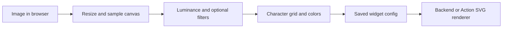

GitAscii has separate image and text conversion paths. The image converter uses browser canvas APIs; the publisher does not rerun that canvas pipeline on every Action refresh.

## Image conversion in the editor

`convertImageToAsciiCanvas` in `src/engine/ascii/converter.ts` loads an image into a browser canvas, downsamples it, converts sRGB channels to linear luminance, and maps the result to a character ramp. It uses luminance weights `0.2126 R + 0.7152 G + 0.0722 B`. Edge enhancement and Floyd–Steinberg dithering are optional.



The ASCII Art renderer consumes stored `asciiText` and color data when present. Without stored art it can use `generateAsciiArt(username, options)`, which generates a username-derived fallback pattern; that function does not download and convert the user's avatar.

Changing editor conversion controls such as dithering or edge enhancement requires regenerating the stored grid. These are not server-side image-processing switches in `AsciiArtRenderer`. Read the exported `CHARSETS` and `AsciiConvertOptions` in the converter for the current ramps and options.

## Text banners

The text converter uses bundled character matrices and takes **positional arguments**:

```typescript
import { convertTextToAscii } from '@/engine/ascii/textConverter'

const lines = convertTextToAscii('GITASCII', 'slant', 1, 'default')
console.log(lines.join('\n'))
```

Signature: `convertTextToAscii(text, fontName = 'block', charSpacing = 1, charsetKey = 'default', customCharset = '')`. Fonts are `block`, `slant`, and `thin`. This path does not require a browser canvas.

Sources: [image converter](https://github.com/Igorcbraz/GitAscii/blob/f248c939a3ea7810c3d3e331ae904b56a72b998f/src/engine/ascii/converter.ts), [text converter](https://github.com/Igorcbraz/GitAscii/blob/f248c939a3ea7810c3d3e331ae904b56a72b998f/src/engine/ascii/textConverter.ts), [ASCII renderer](https://github.com/Igorcbraz/GitAscii/blob/f248c939a3ea7810c3d3e331ae904b56a72b998f/src/features/widgets/renderers/AsciiArtRenderer.ts).
